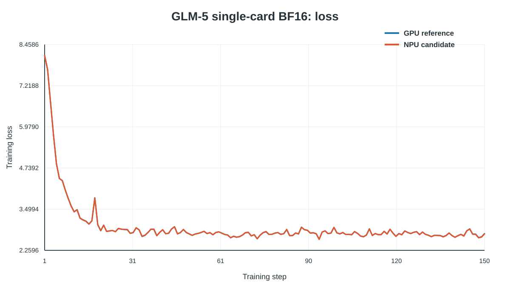
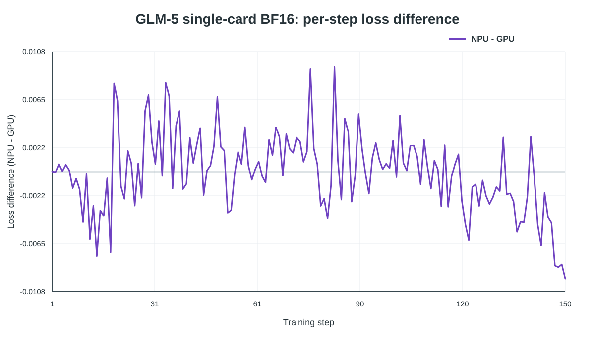

# GLM-5

## 安装

先完成[基础安装](../../INSTALL.md)。本仓提供完整的 GLM-5 模型定义、DSA、MTP、
并行化和 checkpoint 映射，代码位于 `torchtitan_ascend.models.glm5`。模型通过
TorchTitan 的公共配置、训练、并行化和数据接口接入，不复制 Trainer 或通用训练组件。
模型实现与 [TorchTitan PR #5578](https://github.com/pytorch/torchtitan/pull/5578)
中的 GLM-5 实现保持一致，并适配本仓安装指南固定的 TorchTitan
`edde21fb648d446fecb5b78ef42d8c432274b935` 公共接口。上游正式发布后可直接切换到
对应公共模型包。

## 训练配置

配置模块：`torchtitan_ascend.recipes.glm5`。

| CONFIG | 模型 | 数据 |
|---|---|---|
| `glm5_2_debugmodel_npu` | GLM-5.2 debug | 上游自带 tokenizer 和 C4 测试数据 |
| `glm5_2_debugmodel_mtp_npu` | GLM-5.2 debug + MTP | 上游自带 tokenizer 和 C4 测试数据 |
| `glm5_2_scaled_debugmodel_npu` | GLM-5.2 scaled debug | 上游自带 tokenizer 和 C4 测试数据 |
| `glm5_3_debugmodel_npu` | GLM-5.3 debug | 上游自带 tokenizer 和 C4 测试数据 |
| `glm5_3_debugmodel_mtp_npu` | GLM-5.3 debug + MTP | 上游自带 tokenizer 和 C4 测试数据 |
| `glm5_3_scaled_debugmodel_npu` | GLM-5.3 scaled debug | 上游自带 tokenizer 和 C4 测试数据 |

`glm5_debugmodel_npu` 保留为 `glm5_2_debugmodel_npu` 的兼容名称。

默认配置为 BF16、eager、上下文长度 128、每 DP rank 的 microbatch 为 256 tokens，
共训练 10 步。模型随机初始化，不保存检查点。完整训练需自行配置数据、训练步数、
学习率计划和检查点。

## 启动

在 TorchTitan 源码目录执行：

```bash
cd "$TORCHTITAN_SRC"
ASCEND_RT_VISIBLE_DEVICES=0 NGPU=1 ENTRYPOINT=torchtitan_ascend.train \
    MODULE=torchtitan_ascend.recipes.glm5 CONFIG=glm5_2_debugmodel_npu \
    ./run_train.sh
```

验证 GLM-5.3 时，将 `CONFIG` 改为 `glm5_3_debugmodel_npu`。

## Ascend 适配

- ComplexRoPE override 使用 `torch_npu.npu_rotary_mul`，并保留 TP/CP DTensor placements。
- DTensor 参数初始化使用 NPU 可执行的 truncated-normal 路径。
- TP vocabulary-parallel cross entropy 避免对本地词表范围外的 label 取值。
- DSA 使用 TorchTitan FlexAttention 接口表达动态 top-k 稀疏掩码；模型代码不固定 NPU
  attention 后端。
- 完整模型实现暂存于本仓 `torchtitan_ascend.models.glm5`，仅调用固定 TorchTitan
  基线提供的模型配置、并行化、训练和 checkpoint 公共接口，不修改 TorchTitan 源码。

## 支持范围

| 场景 | 状态 |
|---|---|
| GLM-5.2/5.3 模型配置、DSA、MTP 与 checkpoint 映射 | CPU 测试覆盖 |
| GLM-5.2/5.3 NPU recipe 构建 | CPU 测试覆盖 |
| 单卡 BF16、eager 文本训练 | NPU smoke 已验证 |
| 单卡 BF16 整网 loss 对照 | CUDA/NPU 相同 fixture 已完成 150 步对照 |
| TP/CP 下 ComplexRoPE placements | 行为测试覆盖 |
| TP vocabulary-parallel loss | 行为测试覆盖 |
| FSDP、TP、CP、PP、EP 组合训练 | 本 PR 未形成正式精度证据 |
| 图模式和性能优化 | 不在本 PR 范围内 |

单卡 BF16 eager 训练 loss：



逐 step loss 差值（NPU - GPU）：



CUDA/NPU 使用相同 fixture，各完成 150 步训练。长期收敛、稳定性和性能未验证。
